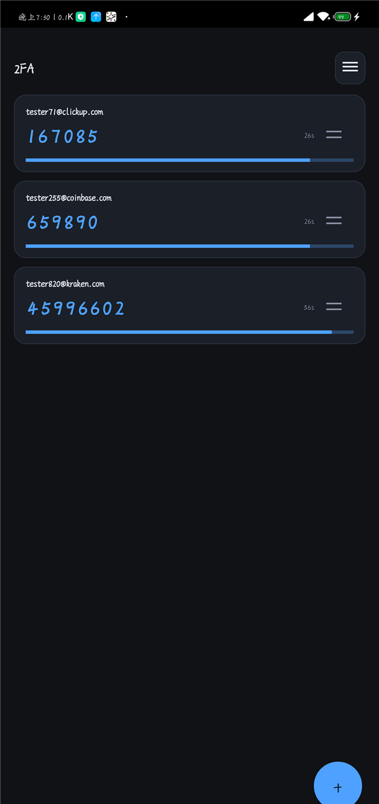

# 2FA

Android 端的 **2FA / Steam 令牌** App —— 独立 Kotlin 应用，**不联网、不碰账号**，只把密钥加密存在本机并出码。

本仓库从 [AccountManager](https://github.com/No-Zero-issue/AccountManager) 拆出（原先是它的 `android/` 子目录）；桌面端密码管理器仍在那边。两边通过二维码同步包协作，**同步格式的改动必须同时改两边的实现与单测**。

## 预览图
<p align="center">
  
</p>

## 功能

- **两种令牌**：Steam Guard（5 位字母）与**标准 TOTP**（6/7/8 位数字，SHA1/SHA256/SHA512）自动识别，共用倒计时与复制交互
- 卡片式列表：大号动态码 + 剩余秒数 + 进度条（≤5 秒变橙），点卡片复制，长按改名 / 删除 / 看撤销码
- **拖动排序**：卡片数字右侧有自绘拖动手柄，按住即可拖动改顺序 —— 被拖卡片**跟手浮动**、原位置塌成空槽、目标位置实时预览，其它卡片**实时让位**，松手立即写入加密存储；右上角菜单「编辑卡片」里同样用这套拖动交互
- 右上角三条杆菜单：编辑卡片 / 从电脑同步 / 关于；右下角圆形＋：手动添加 / 扫描二维码 / 图片导入
- **从电脑同步**：扫桌面端「同步到手机」生成的二维码（多张时扫完一张自动接着弹下一张；也能用「图片导入」逐张选），收齐后按**密钥去重**合并 —— 只新增，绝不删改手机上已有的条目；扫了一半退出可以「继续同步」
- 密钥用 **Android Keystore + AES-256-GCM** 加密存本机（`filesDir/entries.bin`）
- **防丢数据**：写盘先写 `entries.bin.tmp` 再原子改名，覆盖前留一份 `entries.bin.bak`，主文件读不出来时自动回退到备份；启动解析失败时**保持原样**（不清空、不保存），不会把「半截列表」写回去
- 启动器图标为手绘「手机 + 2FA + 锁」线稿：使用 Android 8+ **自适应图标**（黑底 + 白线稿前景，图案已留出安全边距），并附带传统方形 / 圆形多密度图标兜底
- 算法与桌面端一致（HMAC-SHA1 + 26 字母表取 5 位）

## 构建

```
# 测试 + 调试版
gradlew.bat testDebugUnitTest assembleDebug
#   → app/build/outputs/apk/debug/2FA-debug.apk

# 发布版（用 keystore/release.jks 签名）
gradlew.bat testDebugUnitTest assembleRelease
#   → app/build/outputs/apk/release/2FA.apk
```

> Linux / macOS 用 `./gradlew`。仓库根目录就是 Android 工程根目录，不再有 `-p android`。

> 调试版与发布版**签名不同，无法互相覆盖安装**；换签名安装需先卸载，而这会**清空 App 内数据**。
> 签名密钥库与 `keystore.properties` 不在版本控制中（`.gitignore` 有意排除），请自行备份 `keystore/release.jks` 与其中的密码；换机器时把它们放回原位即可构建发布版。

单元测试 23 个用例：与桌面端一致的固定向量、字母表 / 时间窗 / 周期、标准 TOTP 的 RFC 6238 向量、`.maFile`/Base64/otpauth 解析、非法输入拒绝、二维码「编码→解码」往返、同步包解析（含桌面端实际产物样本）。

```
gradlew.bat testDebugUnitTest
```

## 版本号

`versionName` / `versionCode` 只从本仓库根目录的 **`version.h`** 推出来，改那四个数字即可：

| 位置 | 取值方式 |
|---|---|
| `versionName`（系统「应用信息」里显示） | `主.次.修订` |
| `versionCode` | `主*10000 + 次*100 + 修订`（Android 要求只增不减） |
| APK 产物名 | 固定 `2FA.apk` / `2FA-debug.apk`（见 `app/build.gradle.kts` 里的 `androidComponents` 块） |

要临时用别的版本号（例如一次不想动 `version.h` 的热修），在 `gradle.properties` 里取消注释 `androidVersionName` / `androidVersionCode`：只写一个也行，另一个仍从 `version.h` 取，两个都写了就完全不读 `version.h`。

## 与桌面端的同步格式

桌面端「设置 → 📲 同步到手机（2FA）」→ 手机端「右上角菜单 → 从电脑同步」→ 扫码。全程离线：手机端不加 `INTERNET` 权限，密钥只从屏幕上的二维码进手机。

**传什么**：所有填了 2FA 密钥的条目（标准 TOTP 与 Steam Guard 都算），包含名称、类型、密钥、算法、位数、周期，Steam 条目还会带上撤销码；密码、备注等其它字段**不传**。

**多张二维码**：同步包按 900 字节一页切分（约 10~15 条一页，视名称长度而定），一页一张二维码 —— 二维码越大格子越密、越难扫，所以宁可多分几张。

**合并规则**：以密钥去重 —— 手机上已有相同密钥的记录直接跳过，其余追加为**新条目**；不会覆盖、不会删除手机上已有的条目（所以重复同步是安全的）。

**格式**（两个平台必须一致）：

```
AM2FA/1                                    ← 魔数 + 格式版本
1/3                                        ← 本页序号 / 总页数
名称 \t 类型 \t 密钥 \t 算法 \t 位数 \t 周期 \t 撤销码   ← 一条记录一行，制表符分隔
```

- 桌面端打包 / 分页：`frontend/src/syncPackage.js`（在 AccountManager 仓库）
- 手机端解析：`app/src/main/java/com/accountmanager/steamguard/SyncPackage.kt`（复用 `SecretParser` 做 Base32→Base64）
- 兼容性由 `SyncPackageTest` 兜底：测试里直接内嵌了一份桌面端真实生成的同步包

⚠️ 同步包等价于全部 2FA 密钥，别截图外传；扫完即关。

## 许可

本项目以 **GNU 通用公共许可证第 3 版（GPL-3.0）** 发布，Copyright (C) 2026 Account Manager 开发者。
第三方组件（ZXing core / zxing-android-embedded、AndroidX、JUnit）见 AccountManager 仓库的 [LICENSE.md](https://github.com/No-Zero-issue/AccountManager/blob/main/LICENSE.md)。
